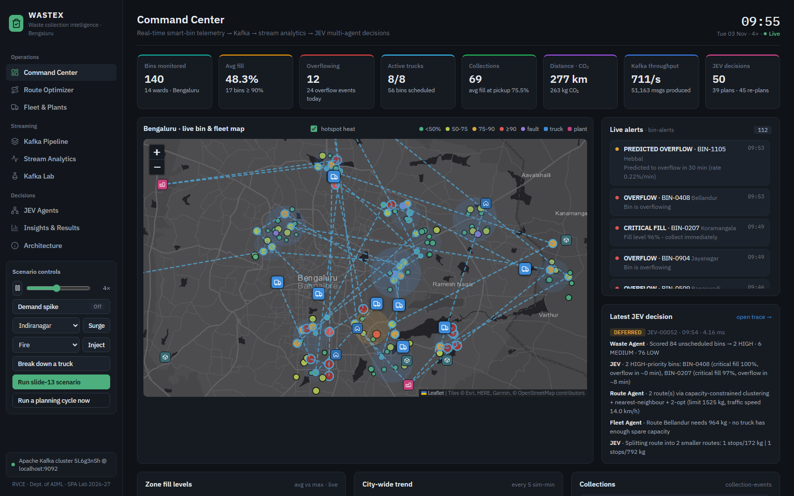

# WASTEX
 
**Real-time, multi-agent waste collection for Bengaluru, built on Apache Kafka.**
 
WASTEX reads live fill-level data from smart bins and decides, every few minutes and whenever something urgent happens:
 
- which bins must be collected,
- in what order,
- by which truck,
- and at which processing plant the load should be unloaded.
It streams everything through Kafka, explains every decision, and runs entirely on one laptop.
 
> Experiential Learning project · Stream Processing and Analytics (AI372IA) · Dept. of AIML, RV College of Engineering · 2026–27
>
> Ibrahim Bagwan (1RV24AI404) · Monil Palak Mehta (1RV23AI058) · Joseph Rejo Mathew (1RV23AI040) · Mentor: Dr. Vijayalakshmi M. N.
 

 
---
 
## Contents
 
1. [The problem](#1-the-problem)
2. [What WASTEX does](#2-what-wastex-does)
3. [Setting up on a new computer](#3-setting-up-on-a-new-computer)
4. [Using the dashboard](#4-using-the-dashboard)
5. [A 10-minute demo script](#5-a-10-minute-demo-script)
6. [How it works](#6-how-it-works)
7. [Results](#7-results)
8. [Project layout](#8-project-layout)
9. [Configuration](#9-configuration)
10. [Verifying an installation](#10-verifying-an-installation)
11. [Troubleshooting](#11-troubleshooting)
12. [Data sources and credits](#12-data-sources-and-credits)
---
 
## 1. The problem
 
Bengaluru collects municipal waste on a fixed timetable: 07:30–09:00 and 18:00–19:30, every day. Bins do not fill on a timetable.
 
- A commercial street in Indiranagar fills several times faster than a lane in Yelahanka.
- A cricket match, a festival or a weekend market changes everything for a few hours.
So some bins overflow long before the truck arrives, while others are emptied half full. BBMP's complaint records show the result: the most common complaint is *"waste gets cleared but comes back."*
 
Our exploratory analysis of the BBMP / OpenCity data pointed to four things a better system must handle:
 
| Finding | What it means for the design |
|---|---|
| A bin going 78% → 84% in 10 minutes overflows before a slow bin at 92% | Decide on the **fill rate and predicted overflow time**, not the level alone |
| Koramangala averaged 67% full while one of its bins was at 91% | Decide **per bin, on the live stream**, not on daily averages |
| Plants have 2,900 TPD of capacity but get 1,150 TPD; MSGP runs at 83% and Kannahalli at 8% | Choose the **disposal plant by spare capacity**, not only distance |
| Complaints cluster in Bellandur (152) and Banaswadi (128) | Give **historically problematic wards** more weight |
 
**The question WASTEX answers:** given hundreds of bins reporting every minute and a small, mixed fleet of trucks, how do we decide in real time **what** to collect, **when**, **in which order**, and **with which truck**?
 
## 2. What WASTEX does
 
- **Simulates a city of smart bins.** 140 bins sit on 14 real Bengaluru wards. Each reports fill level, weight, temperature and battery every simulated minute. You can trigger demand spikes, ward-level surges (match or concert), fires, sensor faults, tampering and truck breakdowns.
- **Streams everything through Apache Kafka.** There are 8 topics with 28 partitions, keyed so that every reading of a bin stays in order. Five independent consumer groups read them.
- **Processes the stream in real time.**
  - Sliding-window fill rate and predicted time to overflow.
  - Anomaly detection: fire, impossible sensor jumps, and tampering, which is told apart from a genuine pickup by joining with collection events.
  - 5-minute zone windows, and a live ranking of the wards where waste is increasing.
- **Decides with three cooperating agents.** An orchestrator, JEV, coordinates them:
  - the **Waste Intelligence Agent** decides *what* needs collecting;
  - the **Route Planner Agent** decides *how*: clustering, batching, route ordering and plant choice;
  - the **Fleet Manager Agent** decides *who*: the best-fit truck by capacity, load and distance.
  When the nearest truck cannot take the load, JEV notices, re-plans and assigns another truck. Every decision is logged step by step.
- **Optimises routes properly.** It compares no optimisation, nearest neighbour, 2-opt, a multi-start 2-opt + Or-opt search (used live) and an exact Held-Karp solver. Routes are drawn on real roads using OpenStreetMap / OSRM. An operator can pick bins on the map and dispatch the optimised route to a truck through Kafka.
- **Closes the loop.** A fleet simulator drives the plans. Each pickup produces a collection event, the bin resets, and the next decision uses the new state.
- **Proves the benefit.** A 24-hour evaluation runs on the identical simulated city with the BBMP schedule, a 4×/day schedule and WASTEX side by side.
- **Teaches Kafka.** A separate interactive lab animates partitioning, consumer groups, rebalancing, lag, replication, broker failure and `acks` settings.
## 3. Setting up on a new computer
 
### What you need
 
| Requirement | Required? | Notes |
|---|---|---|
| **Python 3.10 or newer** | Yes | <https://www.python.org/downloads/>. On Windows, tick **"Add python.exe to PATH"** during installation. |
| **Internet connection** | First run | Downloads the Python packages (and the Kafka image if Docker is used). Map tiles and the real-road route drawing also need internet. |
| **Docker Desktop** | Recommended | <https://www.docker.com/products/docker-desktop/>. Runs a real Apache Kafka broker. Without Docker, WASTEX uses a built-in broker that behaves like Kafka, so the project still runs. |
| **8 GB RAM, 3 GB free disk** | Yes | Docker + Kafka uses about 1.5 GB of RAM. |
| **Chrome, Edge or Firefox** | Yes | Any recent browser. |
 
### Windows
 
1. Copy the `wastex` folder anywhere, for example `C:\wastex`. Avoid folders synced by OneDrive.
2. *(Optional, for real Kafka)* Start **Docker Desktop** and wait until it says *Engine running*.
3. Double-click **`start.bat`**.
The first run takes **3–10 minutes**. The script:
 
1. creates a private Python environment in `.venv`;
2. installs the packages listed in `requirements.txt`;
3. downloads Kafka (about 700 MB, only if Docker is running);
4. opens <http://127.0.0.1:8000>.
After that, `start.bat` starts in under 15 seconds.
 
Keep the black console window open while you use WASTEX. Close it, or press `Ctrl+C`, to stop.
 
| Other scripts | Purpose |
|---|---|
| `start-embedded.bat` | Run without Docker (built-in broker) |
| `stop.bat` | Stop and remove the Kafka containers |
 
### macOS / Linux
 
```bash
cd wastex
chmod +x start.sh
./start.sh
```
 
Use `./start.sh --embedded` to run without Docker. To stop Kafka afterwards, run:
 
```bash
docker compose down
```
 
### Manual setup (any OS)
 
```bash
python -m venv .venv
```
 
Activate the environment.
 
On Windows:
 
```bash
.venv\Scripts\activate
```
 
On macOS/Linux:
 
```bash
source .venv/bin/activate
```
 
Then install the dependencies, start Kafka (optional) and run the app:
 
```bash
pip install -r requirements.txt
docker compose up -d
python run.py
```
 
`python run.py` uses Kafka on `localhost:9092` if it is reachable, otherwise the built-in broker.
 
| Option | Effect |
|---|---|
| `--docker` | Start the Kafka containers first, fall back to the built-in broker if Docker is unavailable (this is what `start.bat` uses) |
| `--kafka` | Require Kafka; stop with an error if it is not reachable |
| `--embedded` | Always use the built-in broker |
| `--port 8010` | Serve the dashboard on another port |
| `--no-browser` | Don't open a browser tab |
 
### What you should see
 
- **Sidebar, bottom left:** *Apache Kafka cluster … @ localhost:9092* (green dot), or *Embedded Kafka-compatible broker* (blue dot).
- **Top right:** the simulated clock, starting at 07:00 and running at 1 simulated minute per second.
- **Within about 30 seconds:** coloured bins on the map, alerts appearing, the first decisions on the **JEV Agents** page, and trucks starting to move.
- **Kafka UI:** <http://localhost:8080> shows the same topics and consumer groups independently (Docker mode only).
## 4. Using the dashboard
 
| Page | What you can do there |
|---|---|
| **Command Center** | Live Bengaluru map: bins coloured by fill, trucks with their remaining routes, depots, dry-waste centres, plants and landfills, with a heat layer showing where waste is building up. Also the headline numbers, the alert feed and the latest decision. |
| **Route Optimizer** | Choose a start (depot or truck), then select places: whole wards with a minimum fill, the 10 most urgent bins, or individual bins on the map. Choose a plant, or *standby* to keep collecting. Compare every routing algorithm on the same stops, see the route on real roads, check which trucks can take the load, and **dispatch** it. |
| **Fleet & Plants** | Every truck's status, load, planned load and stops; km saved by route optimisation; plant capacity and today's deliveries; recent plans. |
| **Kafka Pipeline** | The live topology with throughput, each topic's partitions and offsets, every consumer group's committed offsets and lag, and a message inspector (partition, offset, key, value). |
| **Stream Analytics** | Waste hotspots (kg per hour per ward, trend, *surge / rising / stable / falling*), 5-minute zone windows, the scenario mix, the soonest overflows, alerts by type, and the full bin table. |
| **Kafka Lab** | A self-contained simulation of Kafka internals. Change producer rate, partitions and consumers; switch between keyed and round-robin; kill a broker; change `acks`; send a burst and watch the lag. |
| **JEV Agents** | The decision log. Select any decision to see its path through the workflow diagram and the full reasoning: bin scores, routes, every truck considered and why it was or wasn't chosen. |
| **Insights & Results** | The 24-hour evaluation and the exploratory analysis of the Bengaluru data. |
| **Architecture** | How the system fits together, and why each technology was chosen. |
 
**Scenario controls (sidebar):**
 
| Control | Effect |
|---|---|
| Pause / speed | Pause the clock, or run it at 0.5–8× |
| Demand spike | City-wide ×1.8 waste generation |
| Surge | ×4 in one ward for an hour |
| Inject | Fire, sensor spike, tampering or low battery on a random bin |
| Break down a truck | Its stops are released and re-planned |
| Run slide-13 scenario | Reproduces the example from our presentation (see step 4 of the demo) |
| Run a planning cycle now | Forces JEV to plan immediately |
 
## 5. A 10-minute demo script
 
1. **Command Center (1 min).** 140 bins on 14 real wards, 8 trucks, live clock. Point out the heat circles: these are wards where waste is accumulating fastest.
2. **Kafka Pipeline (1 min).** Messages flowing through 8 topics, 6 partitions on the busiest one, and every consumer group at near-zero lag. Open `bin-telemetry` in the inspector: the key is the bin id, so each bin's readings stay in order on one partition.
3. **Kafka Lab (2 min).** Raise consumers from 2 to 5: a rebalance happens and the fifth consumer sits idle, because 4 partitions can't feed 5 consumers. Click *Kill a broker*: new leaders are elected from the in-sync replicas. Click *Burst of 50*: lag spikes, then drains.
4. **Slide-13 scenario (2 min).** Click *Run slide-13 scenario*; the JEV Agents page opens. Walk through the trace:
   1. bins reach 96% full;
   2. the Waste Agent marks them HIGH;
   3. the Route Agent builds the route;
   4. the Fleet Agent finds the nearest truck has only 20% space left, logged as *constraint detected*;
   5. another truck is assigned and the collection plan is issued.
5. **Hotspots (1 min).** Choose *Yelahanka* and click *Surge*. On **Stream Analytics → Waste hotspots** it climbs to the top, marked *surge*, and turns red on the map.
6. **Route Optimizer (2 min).**
   1. Click *Auto: top 10 urgent*, then *Optimise route*.
   2. In the algorithm table, show how far each method is from the exact optimum and what the live algorithm saves (typically 35–65%).
   3. Show the real-road route and why the plant was chosen.
   4. Click *Dispatch route to truck* and show it moving on the Command Center.
7. **Insights & Results (1 min).** WASTEX vs the fixed schedules.
[`docs/VIVA_QUESTIONS.md`](docs/VIVA_QUESTIONS.md) answers about 45 questions examiners are likely to ask, each with what to show on screen.
 
## 6. How it works
 
```text
 IoT bin simulator ──► bin-telemetry ──► Stream processor ──► bin-analytics ─┐
   (140 bins)                            (rates, ETA,          bin-alerts ───┼──► JEV orchestrator
        ▲                                 anomalies,           zone-aggregates   ├─ Waste agent   (what)
        │                                 windows)                               ├─ Route agent   (how)
        │                                                                        └─ Fleet agent   (who)
        │                                                                              │
        │            collection-events ◄── Fleet simulator ◄── collection-plans ◄──────┘
        └──────────── (bin emptied)          (8 trucks)  ──► fleet-status ──► JEV
                                                                        agent-decisions ──► dashboard
```
 
All components communicate only through Kafka topics. A dashboard consumer group materialises the topics, and the web page receives a snapshot every second over a WebSocket.
 
### Kafka design
 
| Topic | Partitions | Key | Written by → read by |
|---|---:|---|---|
| `bin-telemetry` | 6 | bin id | simulator → stream processor |
| `bin-analytics` | 6 | bin id | stream processor → JEV |
| `bin-alerts` | 3 | bin / truck id | stream processor, fleet → JEV |
| `zone-aggregates` | 3 | zone id | stream processor → dashboard |
| `agent-decisions` | 1 (total order) | — | JEV → dashboard |
| `collection-plans` | 3 | truck id | JEV, operator → fleet |
| `fleet-status` | 3 | truck id | fleet → JEV |
| `collection-events` | 3 | bin id | fleet → simulator, stream processor |
 
The consumer groups are `wastex-stream-processor`, `wastex-jev-orchestrator`, `wastex-fleet-simulator`, `wastex-iot-gateway` and `wastex-dashboard-bridge`. Consumers join their groups before any producer starts, so no early event is missed. A watchdog makes a consumer rejoin if a crash left it without partitions.
 
### Stream processing
 
- **Fill rate:** least-squares slope over the last 10 valid readings, smoothed with an EWMA.
- **Time to overflow:** (100 − fill) ÷ rate.
- **Anomalies:**
  - a jump of more than 15% in one minute is quarantined as a sensor fault;
  - a drop of more than 15% with no matching collection event is flagged as tampering;
  - 60 °C or above is flagged as fire;
  - battery below 15% raises a maintenance alert.
- **Alerts** fire once and re-arm only after the condition clears.
- **Zone windows** are 5-minute tumbling windows on event time.
- **Hotspot trend** compares each ward's current kg/hour with its previous ~45 minutes.
### Decision logic
 
- **Waste Agent.** Priority = 0.35·fill + 0.35·urgency + 0.15·fill-rate + 0.15·complaint history.
  - Urgency is 1 when the bin will overflow within 60 minutes and falls to 0 at 4 hours.
  - Fire and fill of 95% or more force HIGH.
  - Scores of 0.65 or more are HIGH, 0.45 or more MEDIUM, otherwise LOW.
- **Route Agent.**
  - Groups urgent bins into truck-sized clusters.
  - Adds nearby bins that are already over 55% full, to save a later trip.
  - Holds back routes of fewer than 4 non-urgent bins.
  - Orders stops with multi-start 2-opt + Or-opt.
  - Sends the truck to a plant only when it is at least 75% full, choosing the plant with the lowest *distance × (1 + 0.6 × utilisation)*. Closed plants and plants above 90% utilisation are skipped.
- **Fleet Agent.**
  - Rejects trucks that are broken down, unloading, or short of space.
  - Ranks the rest by distance to the first stop plus unused capacity (best fit).
  - Can add stops to a truck that is already on its way.
- **JEV.**
  - Runs every 5 simulated minutes and immediately on overflow, critical fill, predicted overflow, fire or breakdown.
  - Stops early when nothing is urgent.
  - Splits and retries a route (up to 3 attempts) when no truck can take it.
### Routing algorithms
 
| Algorithm | Idea | Cost | Role |
|---|---|---|---|
| As selected | Visit bins in the picked order | — | Baseline |
| Nearest neighbour | Always go to the closest unvisited bin | O(n²) | Starting tour |
| 2-opt | Reverse segments while the route gets shorter | O(n²) per pass | Removes crossings |
| Or-opt | Move chains of 1–3 stops to a better position | O(n³) per pass | Fixes misplaced stops |
| **Multi-start 2-opt + Or-opt** | Both moves, from nearest-neighbour and cheapest-insertion tours | ~100 ms for 15 stops | **Used live** |
| Held-Karp | Exact dynamic programming | O(n²·2ⁿ) | Optimality reference (≤ 11 stops) |
 
On 120 random routes, the live heuristic found the exact optimum 115 times; the average gap was 0.0–0.3%.
 
## 7. Results
 
24 simulated hours on the identical city: 140 bins, 8 trucks, the same random seed. The WASTEX run uses the same agent code as the live system.
 
| Metric | BBMP schedule (2×/day) | Fixed 4×/day | **WASTEX** |
|---|---:|---:|---:|
| Overflow bin-minutes | 6,512 | 2,816 | **467** |
| Overflow events | 62 | 33 | **15** |
| Bin lifts | 280 | 519 | **302** |
| Average fill at pickup | 72% | 51% | **79%** |
| Distance driven | 805 km | 1,264 km | 1,298 km |
 
| Compared with | Overflow time | Overflow events | Other |
|---|---|---|---|
| BBMP schedule | −93% | −76% | — |
| 4×/day schedule (comparable distance, within 3%) | −83% | — | 42% fewer bin lifts; bins about 79% full when collected instead of 51% |
 
The BBMP schedule drives the least only because it lets bins overflow.
 
Reproduce the evaluation with:
 
```bash
python -m backend.benchmark
```
 
**Live system on Kafka:**
 
- all five consumer groups at zero lag;
- around 140 telemetry messages per second at 1× (several hundred at higher speeds);
- agent decisions in a few milliseconds;
- route optimisation saves roughly 20–35% of the distance of visiting bins in urgency order.
## 8. Project layout
 
```text
wastex/
├── start.bat · start.sh · start-embedded.bat · stop.bat   launchers
├── run.py                     starts Docker Kafka (optional) and the server
├── docker-compose.yml         Apache Kafka 3.7 (KRaft) + Kafka UI
├── requirements.txt
├── backend/
│   ├── app.py                 web server, WebSocket, controls, route API, health check
│   ├── config.py              topics, consumer groups, thresholds
│   ├── bus.py                 Kafka client wrapper + built-in Kafka-compatible broker
│   ├── core.py                simulated clock, distances, traffic and demand models
│   ├── routing.py             nearest neighbour, 2-opt, Or-opt, Held-Karp, OSRM roads
│   ├── bridge.py              dashboard consumer group and hotspot analytics
│   ├── benchmark.py           24-hour evaluation
│   ├── data/bengaluru.py      wards, dry-waste centres, plants, landfills, complaints
│   ├── simulator/iot.py       smart bins and scenarios
│   ├── simulator/fleet.py     trucks
│   ├── streaming/processor.py stream processor
│   └── agents/                waste, route and fleet agents + JEV orchestrator
├── frontend/                  dashboard (HTML, CSS, JavaScript; Leaflet, Chart.js)
├── tests/system_check.py      end-to-end check against a running server
└── docs/
    ├── WASTEX_Project_Report.docx   project report (department format)
    ├── VIVA_QUESTIONS.md            likely questions and answers
    ├── build_report.py, make_figures.py, finalize_report.ps1
    ├── figures/                     charts used in the report
    └── screenshots/                 dashboard screenshots
```
 
## 9. Configuration
 
Thresholds and timings live in `backend/config.py`. They include the planning interval, the window sizes, the priority thresholds, the disposal threshold and the road model. Change a value, then restart.
 
Environment variables:
 
| Variable | Default | Meaning |
|---|---|---|
| `WASTEX_BUS` | `auto` | `kafka`, `embedded` or `auto` |
| `WASTEX_KAFKA` | `localhost:9092` | Kafka bootstrap server |
| `WASTEX_SEED` | `42` | Random seed for the simulated city |
| `WASTEX_BINS_PER_ZONE` | `10` | Bins per ward (14 wards) |
 
| Port | Used by |
|---|---|
| 8000 | WASTEX dashboard |
| 9092 | Kafka broker |
| 8080 | Kafka UI |
 
## 10. Verifying an installation
 
With WASTEX running, open a second terminal in the `wastex` folder and run:
 
```bash
.venv\Scripts\python tests\system_check.py
```
 
On macOS/Linux use `.venv/bin/python tests/system_check.py`.
 
It takes about two minutes. It runs 42 checks:
 
- every pipeline thread and topic;
- every scenario control;
- anomaly detection;
- the agents;
- consumer lag;
- the route optimizer;
- dispatch to a truck;
- the evaluation.
It ends with `42/42 checks passed`.
 
For a quick health check while the system runs, open <http://127.0.0.1:8000/api/health>.
 
## 11. Troubleshooting
 
| Symptom | Fix |
|---|---|
| `Python 3.10 or newer was not found` | Install Python from python.org with *Add to PATH* ticked, then open a new window. If typing `python` opens the Microsoft Store, turn off *App execution aliases* for Python in Windows Settings. |
| `start.bat` says Docker is not running and uses the built-in broker | Start Docker Desktop, wait for *Engine running*, and run `start.bat` again. If Docker Desktop hangs while starting, restart it from its tray icon; it may be waiting for an update or a sign-in prompt. |
| Port 8000 already in use | `run.py` opens the existing WASTEX if it is already running. Otherwise start on another port: `.venv\Scripts\python run.py --docker --port 8010`. |
| Port 9092 or 8080 already in use | Another Kafka or service is running. Stop it, or change the left-hand port numbers in `docker-compose.yml`. |
| Map is grey, or routes are straight lines | Map tiles and real-road routes come from the internet (Esri, OSRM). Everything else works offline. Routing then uses the modelled road distance. |
| *Insights & Results* says it is running the evaluation | It takes about 45 seconds after start-up, once. |
| No decisions appear on *JEV Agents* | Open <http://127.0.0.1:8000/api/health> and check that every thread is alive. Restart with `start.bat`; consumers automatically rejoin their groups. |
| You want a completely fresh Kafka | Run `docker compose down -v`, then `start.bat`. |
| Package installation fails | Check your internet or proxy, delete the `.venv` folder, and run `start.bat` again. |
| Rebuild the report after changes | Run `.venv\Scripts\python docs\build_report.py`, then `powershell -ExecutionPolicy Bypass -File docs\finalize_report.ps1` (refreshes the table of contents in MS Word). |
 
## 12. Data sources and credits
 
- **Dry waste collection centres, processing-plant capacities, landfills and ward complaint records:** BBMP data published on OpenCity (<https://opencity.in>).
- **Smart-bin telemetry:** synthetic. No public live feed exists. It is calibrated to the EDA (0.2–0.6% per minute at peak) and generated from a fixed seed, so results are reproducible.
- **Maps:** Esri basemap, © OpenStreetMap contributors. **Road routes:** OSRM (Project OSRM public server).
- **Built with:** Python, FastAPI, Apache Kafka 3.7, kafka-python, Leaflet, Chart.js and IBM Plex fonts.
 